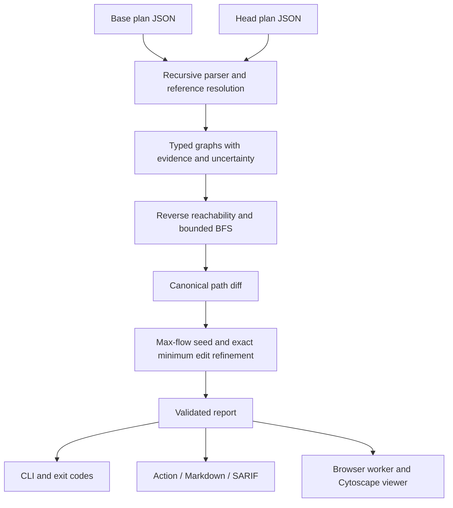

# Architecture and decisions

The engine has no Node-only imports. `src/engine` is shared by the CLI, Action bundle and browser worker. Terraform remains a separate input-producing step; the checker never runs HCL, providers or application provisioners.

## Input and graph

The parser accepts Terraform JSON format major 1, planned values and nested modules. It rejects state files, errored plans, explicitly incomplete plans, malformed resources and duplicate addresses. Deleted resources are excluded. `resource_changes.change.after_unknown` augments the partial planned values. A mask containing only `false` leaves is known; the real Terraform fixture exercises this distinction.

Known IDs, names and ARNs resolve links first. Configuration expressions provide dependency references when values remain unknown. Such references are possible links, not evaluated values. Module-scoped resource references are supported; general HCL expression evaluation and transitive module output/variable evaluation are not.

Nodes are Internet, SecurityGroup, Instance, Role, Bucket and Database. Ancillary resources such as profiles, policies, subnets and route tables supply edges/evidence rather than cluttering path diagrams. All buckets and databases are targets in this release. There is no tag-selected crown-jewel filter yet.

Edges distinguish public ingress, networking, credential use, IAM grants, role assumption and escalation. They retain certainty, evidence and an optional semantic edit. Address family and public database port constraints travel through BFS, so IPv6 ingress cannot be combined with an IPv4-only attachment and unrelated ports do not establish direct database access.

Known private addressing and known route tables without an IGW default route stop direct internet paths. Missing routing evidence yields possible reachability. NAT gateways do not provide inbound internet access. Public IPs and SGs alone do not prove listener availability or compromise. The instance-to-role edge explicitly assumes application exploitation/SSRF and credential theft; it is always possible. Database pivots require a source-SG reference and assume credentials, source egress and private routing.

## IAM subset

Action matching is case-insensitive; ARN matching is case-sensitive, with `*` and `?` globs. `s3:ListBucket` and bucket-only ARNs do not grant object read. The implemented read actions are `s3:GetObject` and `s3:GetObjectVersion`. Explicit unconditional matching identity-policy denies override allows. Locally available permissions boundaries must also allow the operation. Conditions, negated constructs and unavailable policy documents introduce uncertainty.

The recognized AWS managed-policy subsets are AdministratorAccess, AmazonS3FullAccess and AmazonS3ReadOnlyAccess. Other attached policies require local documents, otherwise grants are possible. These are supported capability subsets, not live copies of AWS policies. External IAM controls are not fetched.

The four escalation rules follow the [Rhino Security Labs catalogue](https://github.com/RhinoSecurityLabs/AWS-IAM-Privilege-Escalation):

1. `iam:PutRolePolicy` on the current role can add a read grant.
2. `iam:AttachRolePolicy` on the current role may attach a broader policy; existence and attach conditions remain assumptions.
3. `iam:CreatePolicyVersion` on an attached customer-managed policy can make a broader version default.
4. `iam:UpdateAssumeRolePolicy` on another role, together with `sts:AssumeRole`, may change trust and assume it.

Mutating another role's inline policy does not produce its credentials. `iam:PassRole` alone does not establish code execution or credential use. These cases have negative tests. Successful self-mutation cannot bypass a known unconditional S3 deny or known restrictive boundary. Escalation results are possible, including additional effective-policy prerequisites.

## Search and identity

Reverse reachability prunes nodes that cannot reach any target. BFS then enumerates simple paths, stopping at the first data target. Per-path visited nodes prevent cycles without losing distinct predecessors. Defaults: 4,000 paths, 24 edges, 100,000 states. Exceeding any cap throws; neither the CLI nor Action can turn it into a clean check.

Canonical IDs use resource addresses and semantic edge records. Deterministic dual 32-bit hashing is shared by Node and the browser; path/edge collisions within a graph/search throw. Resource order, object-key order, SG rule order and IAM action/statement order do not define identity. Distinct ports, grant actions and capability edges can produce separate paths. Policy descriptions do not establish access. This is a versioned implementation identity, not a cryptographic attestation or a stable API across model changes.

Certainty participates in identity: a possible-to-definite change is removed + introduced, and is gated. Renamed/moved Terraform addresses also produce removed + introduced. A semantic capability change is not hidden by an unchanged resource sequence.

## Minimum changes

Each removable ingress rule, IAM statement or instance-profile assignment costs **one edit**. Costs describe the number of supported edits, not operational disruption. Uneditable evidence edges have effectively infinite capacity. A two-attribute fix is not presented as a single edit.

Edmonds–Karp max-flow uses BFS augmentations and residual reverse arcs to seed a minimum cut. Shared edits get one capacity gate, so one IAM statement or ingress rule can block many paths. Such gate sharing can create recombined routes in the transformed graph. Claiming that graph cut alone is the minimum change to the original enumerated paths would be incorrect.

An exact branch-and-bound hitting-set refinement therefore minimizes distinct edits over all introduced paths. A disjoint-constraint lower bound, memoization and the flow solution bound the search. Every returned edit set is verified to intersect every introduced path. The solver fails after 200,000 states rather than claiming unverified minimality. Exhaustive enumeration tests small randomized instances against the solver.

Minimality applies to **supported edits on the enumerated introduced paths**, not every possible AWS fix or every existing path. The chosen set can also remove unchanged paths. Alternative edits with equal cardinality are not ranked by business impact. No Terraform file is rewritten automatically. Rule/statement hashes in attribute selectors identify semantic blocks; they are not literal HCL indices.

## Delivery and privacy

The Action takes either base/head plans or a precomputed report. Artifacts precede gate failure. Missing inputs, malformed reports, demos without explicit opt-in and incomplete analyses fail. Count-only logs are the default; comments are opt-in and cannot erase a gate failure.

Production viewer scripts/styles/Cytoscape are bundled with no CDN or backend. A worker performs analysis and can be terminated. CSP blocks `connect-src`, and Zod's optional dynamic-code probe is disabled. File contents live in memory. The diagram shows one path at a time with an equivalent textual sequence. Exports deliberately include resource details.

The original delivery-only scaffold is now connected to the implemented engine. This project does not claim independent human authorship of generated algorithms or labels; readers should inspect and challenge the model and evaluation.
